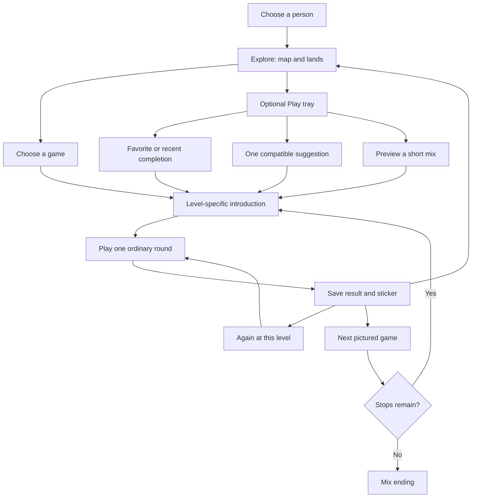

# Discovery and a groove of play

*2026-10-12 · research and design only · source baseline `cb3d24f`*

The island should welcome two intentions: **“Let’s explore”** and **“Let’s play.”** A person can enjoy visiting lands and hosts, then choose a run of games without retracing the catalog after every round. Those intentions can change within one visit. Keep one catalog, one profile and the same game rules underneath both.

Integrated against `61f7d8c` after another session’s Fruit Sums addition; the audited app/progress/couch runtime is unchanged from the source baseline.

The developer requested this study after the [family review](FAMILY-EXPERIENCE.md), with Just Dance as a reference. This document defines proposed flows and bounded future slices. No session mode, recommendation screen, introduction shortcut or automatic handoff was implemented. The [roadmap](ROADMAP.md#next-up) governs readiness; existing product decisions still apply.

## What Just Dance usefully separates

Ubisoft’s Just Dance 2023 designers describe easier song selection, personalized recommendations and playlists that reduce returns to the song menu. They also describe different audiences wanting different kinds of sessions. The transferable idea is several entrances to the same activities: a remembered favorite, something discovered while browsing, a prepared sequence, or a compatible surprise. It is a product-design precedent, not proof that playlists improve children’s learning. [Creative-director and producer interview, 2022](https://news.ubisoft.com/en-us/article/7GS9RNpDpxwEU9hYJIWYsy/just-dance-2023-edition-has-some-new-moves).

The version 24.2.0 **Surprise me!** feature chooses within the player’s owned songs and current library filters, and allows another pick. Version 25.0.0 documents custom playlists, while the 2026 Party Mode announcement describes short songs, selectable session length/difficulty and solo or group play. These are distinct features across editions, not one universal Just Dance interface. [24.2.0 notes](https://www.ubisoft.com/en-us/game/just-dance/2024/news-updates/3FgPdQ3EFYqLANeV0w1qXV/version-2420-patch-notes), [25.0.0 notes](https://www.ubisoft.com/en-us/game/just-dance/2024/news-updates/26uQ47e8rDMqjFc6vFFYPO/version-2500-patch-notes), [2026 modes](https://www.ubisoft.com/en-us/game/just-dance/2026/news-updates/5lXkJAggFhXne0x75Pg5O2/2-new-game-modes-coming-to-just-dance-2026-edition).

**A playlist need not mean automatic launch.** Ubisoft’s 2023 playlist help describes a leader choosing Next Activity after results and being able to skip songs. A single understandable continuation can remove catalog work while retaining a stopping point. Here, call it **Next game**, with the next game’s picture; keep **Next level** a different action. [Playlist help](https://www.ubisoft.com/es-es/help/just-dance-2023-edition/gameplay/article/playlists-in-just-dance-2023-edition/000103702).

Just Dance’s accessibility spotlight describes filters for seated dances, no jumping and no floorwork, alongside readable song names and optional menu previews. Puddle’s equivalent is information about the action actually required: tap, drag, steer, listen, read or coordinate with someone. Genre and age alone do not describe whether a game suits the person’s current circumstances. Only label accommodations that have been reviewed and actually work. [Accessibility spotlight](https://news.ubisoft.com/en-gb/article/4PvGQbg9rxVwrRqaanBfv5/just-dance-2023-edition-accessibility-spotlight).

Puddle does not need subscriptions, limited-time offerings, time-of-day profiling, exercise statistics or an online recommendation service to borrow these selection ideas. Session size can be a number of games rather than a duration. A whole Puddle game also changes controls and concepts more than another dance does, so a playlist must explain unfamiliar actions and modes.

## What the island does today

| Current behavior | Implication for discovery |
| --- | --- |
| The map has themed lands, hosts, signposts and a home catalog; places remember navigation position for the session | Preserve exploration and remembered locations as a complete route, not scenery behind a new mandatory launcher |
| A host suggests an unplayed game, then a least-recently-completed one, avoiding its previous suggestion | A simple explainable selector already exists; extend it carefully before inventing recommendation infrastructure |
| Favorites are bounded; the visible shelf is a subset. History records completed rounds | “Play again” can mean replay a completed game. It cannot promise resumption of an abandoned round or remembering every game merely opened |
| The celebration offers Again, Next level, Home, Heart and sometimes Keep | Choosing a different game requires returning to the catalog. There is no cross-game Next game action |
| `finish()` records the result, awards the sticker and requests a save before the celebration | Changing result presentation must preserve exactly-once completion and the durable save boundary, rather than move saving into the next-game button |
| The celebration has about 3.7 seconds of explicit waits before buttons appear; a new discovery adds 1.8 seconds | This is source timing, not a measured complaint. A quicker optional result is a useful hypothesis to test |
| A normal launch opens a full level-specific how-to card; Again, the current Next level button, stories and the grown-up switch skip it | Cross-game play must preserve that policy initially. Passing `again: true` for a different game would conceal a behavior change |
| Couch trips already offer a finite sequence, seeded alternatives and explicit settling of results | Reuse the design lesson, not their unlock tiers, fixed stop levels, controller-only presentation or separate couch save |

The current `flush()` starts an asynchronous write and does not provide an awaited durable-completion receipt to `GameScene`. Preserving its call before presentation is necessary; it is not proof of crash-safe itinerary persistence. D5b must define consistent round/item receipts and verify the save/transition boundaries before claiming a resumable session.

Source pointers: `src/app/scenes/GameScene.ts` (`finish`, `celebrate`, `openIntro`), `src/content/lands.ts` (`suggest`), `src/content/shelf.ts`, `src/progress/store.ts`, `src/couch/party.ts`, `src/app/routes.ts`. The current island does not sample controllers; some controller games support only part of their ladder, and controller-only routes currently lose island origin/level. The first island flow pilot should use working touch games.

## Two entrances, several intentions

Use **Explore** and **Play** as the conceptual top level. Do not put a six-mode questionnaire between choosing a profile and its island. The current map remains the default; an optional pictured Play tray can live in the home spot and be reachable again from a round’s result. Placement on the crowded map needs a layout sketch, not another arbitrary landmark.

| Intention | Proposed flow | Useful for | First scope |
| --- | --- | --- | --- |
| **Explore the island** | Map → land/host → game → result → same place | Curiosity, familiar geography, stories, showing creations | Existing route, with an optional “play something else” shortcut |
| **Play again** | Play tray → recent completed game or favorite → matching intro/round | Someone knows what they enjoyed and wants it quickly | Derive from existing favorites/history; preserve all saved favorites through pages |
| **Pick for me** | Choose a scope → one pictured suggestion → Play or Another → round → next suggestion | Someone wants fewer catalog decisions while retaining choice | A small reviewed candidate pool and predictable selection |
| **Play a mix** | Pick a named sequence → see three game pictures → start → Next game / Again / Explore → a complete ending | A child with a grown-up, a relaxed puzzle session, trying a few different things | One authored three-game touch mix; no editor or saved queue needed |
| **Make my mix** | Choose a few games → arrange the pictures → play the sequence | A person/family already knows what they want | Later, bounded local selection; persistence is a separate slice |
| **Follow an invitation** | Friend’s request → meaningful story steps → ending | A world goal, causal continuity and role play | Existing Windy Picnic; new episodes keep their own definitions |
| **Stay with this** | Again at this level, or deliberately choose another mode of this game | Deep practice, a relaxing favorite, revising a creation | Existing replay plus the separately proposed mode gallery |

These are intentions within the same world, not seven new age places, saves or mandatory screens. **Pick for me** is a one-game choice; **Shuffle** later orders an eligible pool; **Mix** is an authored or chosen sequence. A generic random button cannot stand in for all three.

### Keep discovery part of the world

Let a host offer a small pictured mix using that land’s games, so direct play still feels like a visit with a familiar character. A pet-carried itinerary can show the next destination without becoming another collectible or obligation. The same game keeps its drawing, name and land identity in the library, result screen and mix. Quiet optional landmark reactions can reward exploring, but decoration should not look like a dead game button. An authored episode remains the route for lasting causal changes; a playlist does not pretend that merely finishing unrelated games repaired the island.

Someone who prefers wandering can ignore the Play tray entirely. Someone who prefers direct play should be able to reach the next activity without an obligatory tour. A later explicit start preference can shorten their next visit while keeping Explore easy to reach.

### How the routes can meet



The diagram’s intro is the current full-card policy. A shorter session introduction and automatic continuation are later proposals below. The Next game branch appears only when a suggestion or itinerary exists; ordinary free play does not secretly create a queue.

## A round boundary that keeps the groove

For a session, the first useful result flow is:

**Save the completed round → acknowledge its sticker → show Next game’s picture, Again, and Explore.**

Next game returns directly to the selected game’s introduction; it avoids returning to the map, locating a land and browsing again. Keep its name/action replayable, show its input requirement, and let the player inspect or replace it. The choice waits indefinitely. Use a distinct icon/label for Next game and Next level; do not assign the existing orange “harder level” arrow a new meaning without changing its cue.

Initially retain the existing celebration and card. First prove the routing and accounting improvement. Then pilot a **brief result presentation** with stopping/navigation controls available once the round is safely settled. Local animation can continue while buttons are available; it never intercepts them. Keep a clear sticker acknowledgment, Heart, and any explicit Keep choice. New journal evidence remains reachable. D1/D2 retain the current optional Keep and deliberate navigation: a pending creation remains available until the player chooses to leave or advance. Do not automatically save it or overwrite it during a passive preview. An additional required keep/discard confirmation or changed creative-result layout is a D4 product decision, not a new gate on the first pilots.

**Again** repeats the just-finished level and creates another ordinary round/result/sticker. It keeps the upcoming itinerary unchanged. **Next level** follows that game’s ordered ladder and also stays in the current itinerary position. **Next game** consumes the current position once and launches the next. Completing with help still finishes the position; assistance remains recorded in that game’s round. Each played round has its own settlement token; the itinerary position has a separate stable token that counts it once. The mix itself never adds a bonus sticker or totals mistakes across activities.

**Skip** is available in a preview and through the deliberate pause/leave route during play. It abandons that unfinished round, settles the itinerary position as skipped and offers the next one. It adds no sticker, play count, wrong answer, hint or difficulty change, and does not mark the game as explored/completed. If that position was already completed before an unfinished Again/Next-level round, skipping abandons only the extra round: its earlier played state and rewards remain, and the position is not relabeled skipped or counted twice. A skipped unfamiliar game can still be suggested later. A sequence ends after its positions have been played or skipped; it does not generate replacements indefinitely.

**Explore** leaves the round cleanly and returns to its launching place/page. For the first pilot, leaving ends the transient mix; completed rounds remain saved. Later, an explicit “Keep this mix here” option can suspend the itinerary during the same visit. Ordinary games played on that detour must not advance it or replace its upcoming items. A pictured “Return to my mix” restores the next position. Reload/profile change ends an unsaved itinerary, so do not advertise durable session resumption until bounded storage is built.

### Introductions: reduce duplication without losing support

Three alternatives deserve comparison:

| Approach | Behavior | Recommendation |
| --- | --- | --- |
| **Full card on each new game** | Current goal, gestures, finish, level description, matching demo and Play, with the existing Again/Next-level exceptions | Preserve this in the first routing pilot; it provides a known baseline |
| **Next-game card doubles as the intro** | The next-game preview contains the same required information/demo and explicit Play, so another selection screen is unnecessary | Best next prototype: one useful decision surface, still accurate at the launch level |
| **Brief introduction for an introduced mode** | After an explicit session choice, a previously introduced game/level/input can start with a short replayable cue; a new mode still gets the full card | Later product decision. Do not infer familiarity or mastery from a game’s total play count |

A session can remember which exact `(game ID, resolved band, level ID, input route)` was introduced **during that session**, and revalidate when the next round launches. This is UI support state, not independent mastery. An adaptive level change, pin change or input change may need another introduction. Existing pet replay and `?` remain available. Never overload the existing Again flag to suppress a different game’s card.

### Truly automatic handoff

An optional **Keep moving** setting could start the next preapproved game after the result, within one visible finite mix. It is separate from simply removing catalog steps. Recommend keeping it off initially and testing explicit Next game first.

If pursued: a grown-up/player explicitly opts in for that mix; the lineup and modes are inspectable; only eligible introduced interactions use automatic handoff; a new mode, pending Keep choice, new instruction, changed input or interrupted page stops at a waiting preview. Always expose Pause/Explore, stop when the mix ends, and never start another mix automatically. Suppress the input that completed the old game until release and require a fresh input for a confirmation or navigation button. No countdown, expiring choice or hidden transition timer is needed; do not turn automatic handoff into an endless feed.

This needs an explicit introduction/result-flow decision and a lifecycle/accessibility definition before implementation. The user’s openness to multiple modes authorizes this research, not a silent change to the current every-game intro or stopping behavior.

## Choosing games that suit the moment

Begin with **reviewed pools and authored sequences**, not machine learning. Resolve suitability before preference:

1. The game exists and its chosen route/level actually supports the intended input. A declared controller capability does not make the current island controller-ready. No surprise request for a keyboard, second person or device permission halfway through a mix.
2. Automatic suggestions normally use games for the active person’s band or younger. Older signpost games stay freely available through deliberate exploration/library choices; include them in a mix only when explicitly selected.
3. At launch, resolve `playBand`, then `store.levelFor` so the current pin and saved ordered level apply. A preview must refresh if these changed. A deliberately chosen one-round level override must be clearly shown; a playlist never globally raises difficulty.
4. Honor the chosen scope: favorites, “something new,” a particular land, making, movement, music or puzzles. Empty pools offer another scope or Explore without silently substituting an incompatible game.
5. Choose content variety within that scope. Avoid immediate repeated suggestions and draw without replacement within a finite mix when enough candidates exist. Treat an explicit replay/repeated custom slot as intentional. Avoid flickering/reordering suggestions after every frame or completed round; refreshing is deliberate.

A first three-choice shelf can show **a favorite/recent completion**, **something unplayed**, and **a different action**. Overlapping candidates appear only once; missing categories need an honest fallback. A new player gets three varied reviewed activities rather than empty favorites. Alternatively, **Pick for me** reveals just one suggestion and an Another button. Comparing these is a usability question; three is a prototype size, not a scientifically ideal number.

Do not equate “struggled” with “dislikes,” infer readiness from helped completion, or make returning to neglected games a duty. Preference comes primarily from deliberate hearts, selected scopes and replacements. A simple “because you chose music” or a pictured favorite marker explains a recommendation without a profiling dashboard.

### Flow is more than subject variety

A mix should consider changes in **gesture, attention, explanation and ending**, not just a different subject on every stop. Two games in one subject can feel very different; two across subjects can both be repetitive tapping. Begin with familiar controls, vary the action/content, and avoid introducing several new gestures in succession. Longer creative rounds need a player-chosen finish, and cannot be promised as one-minute stops.

| Proposed mix | Current compatible example | Intended rhythm / caveat |
| --- | --- | --- |
| **Little surprises** | Bubble Pop → Sing-Along Barn → Fill and Dump, lap/toddler touch | Cause/effect, familiar song, hands-on toy; an adult can prepare it. Actual selected modes still need fit/finish observation |
| **Look, listen, fit** | Photo Safari → Sound Garden → Shape Sorter, preschool touch | Notice, listen, place; test whether the listening change is pleasant or needs more explanation |
| **Plan, test, make** | Robot Path → Chain Reaction → Pixel Pictures, school touch | Plan, replay a consequence, express a choice. These games do not yet carry a shared object/result between them |
| **Cozy puzzles** | Tile Pairs → Gem Swap → Lantern Lights, grown-up touch | Distinct puzzle rules with a quieter presentation; all have controller implementations too, but an island controller mix must wait for that working route |
| **Stay in a place** | A small reviewed pool from one land | Less conceptual switching, a familiar host and props; do not silently change the launch band to fit a title |

Before implementation, every authored mix needs its explicit game IDs, resolved-band policy, input route, stopping/skip semantics and observed instruction demands. A theme is not a story: “Plan, test, make” is a sequence, while a Woodland Picnic must make each action change its world situation.

### Different people, different preferences

Young co-play can favor an adult-prepared short picture sequence. A preschooler may enjoy knowing what is next; a school-age player may want to replace or arrange stops; an adult may want literal search, favorites, a thoughtful puzzle mix or shuffle. These are hypotheses, not age rules. Offer the same open routes with suitable presentation and let people choose.

The first pilot credits one active profile, with the ordinary co-play prompts. “Family mix” must not imply that every stop has multiplayer roles. Genuine shared-role filters and multi-profile turns wait on the existing [seat/credit decisions](WAITING-ON-DEVELOPER.md#waiting-on-the-developer). Changing the active person clears the transient itinerary and rejects stale result/navigation callbacks.

Later, a per-profile **Start with Explore / Start with Play** preference could suit returning players. Default to the present map; do not silently infer a preferred launcher or restore a different person’s queue. Saving preferences, custom mixes or incomplete itinerary receipts is a separate bounded save/migration/backup slice. Completed game progress already survives leaving; unfinished-round state generally does not.

## Other references and research limits

| Primary reference | Useful precedent or evidence | Limit and Puddle interpretation |
| --- | --- | --- |
| [Nintendo: WarioWare Get It Together](https://play.nintendo.com/news-tips/game-releases/warioware-game-announcement/) | Cooperative Story play and a separate Variety Pack serve different play intentions | Borrow distinct ways to enjoy one activity library and funny consequences; not its speed, lives, competitive pressure or rotating obligation |
| [Nintendo: Jamboree multiplayer instructions](https://en-americas-support.nintendo.com/app/answers/detail/a_id/66549/~/how-to-start-a-multiplayer-game-%28super-mario-party-jamboree%29) | Modes can be reached through spatial destinations or quick map/mode switching; input/player requirements vary | Explore and fast selection can coexist. This is a product precedent, not proof for Puddle’s exact layout |
| [Ryan, Rigby and Przybylski, 2006](https://selfdeterminationtheory.org/SDT/documents/2006_RyanRigbyPrzybylski_MandE.pdf) | Studies associate autonomy/competence and usable controls with enjoyment and preferences | Not a lap/preschool catalog experiment. Supports testing control, declining and choice; does not validate a recommendation ratio |
| [Chernev, Böckenholt and Goodman, 2015](https://myscp.onlinelibrary.wiley.com/doi/abs/10.1016/j.jcps.2014.08.002) | Choice overload depends on complexity, decision difficulty, preference uncertainty and the goal | Consumer-choice synthesis, accessed through its abstract. A small starting set alongside a full library is a design hypothesis, not a universal three-card law |
| [Xbox Accessibility Guideline 116](https://learn.microsoft.com/en-us/xbox/accessibility/xbox-accessibility-guidelines/116) | Give people enough time to read, interpret and act on interface information | Next-game choices/instructions wait for input; faster transitions must not erase necessary support. Guidance is not a study of children’s learning |

No claim of educational effectiveness or optimal session length follows from these references. “In a groove” here means the next action remains enjoyable and understandable with less unwanted selection work, not that people play longer. Office-interruption studies are too distant to establish that a child’s sticker celebration is harmful; the current ceremony should be compared in play, not removed on that assumption.

## Build slices after this study

The developer requested concrete roadmap actions on 2026-10-12. [ROADMAP’s discovery action table](ROADMAP.md#discovery-actions) now owns their live status, order, dependencies, next-session scope, exit evidence and check tier. No implementation is claimed. These actions share chunk 19; controller migration, family credit, mode galleries and land overflow retain their separate claims/decisions.

| Research concept | Roadmap actions | Relationship |
| --- | --- | --- |
| **D1 · Direct next choice** | **D1a** first screen/pool packet → **D1b** playable feature | First pilot is one pictured suggestion, with Another, using Bubble Pop/Sing-Along Barn/Fill and Dump at lap/toddler. The former one-card-or-three-shelf alternative is resolved for this first packet; future selection scopes remain D7 |
| **D2 · One visible three-game mix** | **D2a** Little surprises lifecycle/entry packet → **D2b** playable mix | Exact three-game sequence, pictured home entry, normal per-game results, separate round/item tokens, Next/Again/Skip/Explore and a complete ending; initially in memory |
| **D3 · Combined preview and introduction** | **D3** full-card layout/lifecycle definition | Removes a redundant selection surface while retaining required goal, level actions/finish, matching demo, speech and explicit Play; cannot silently change introduction policy |
| **D4 · Brief result and introduced-mode support** | **D4a** compact-result choice; **D4b** session-support choice | Separate developer decisions. Neither blocks the direct-next/mix pilots; each has its own later definition and affected shell checks |
| **D5 · My mix and saving** | **D5a** bounded transient editor → **D5b** explicit per-profile storage/receipts | Choose/reorder first, durable resume separately; no unfinished-round restoration claim without actual game support |
| **D6 · Keep moving** | **D6** finite automatic-handoff choice | Later explicit opt-in, after deliberate Next and support behavior work; interruptions, changed input/mode and pending Keep return to a preview |
| **Other discovery entrances** | **D7** scoped pick/shuffle; **D8** profile start preference; **D9** favorites/recent/library | Reuse working selection, planner and entry routes. Do not infer preferences, create endless refills, change favorites limits or promise saved sessions by adding a shortcut |

**Next action:** define D2a; D1b is built from the [frozen D1a packet](#d1b-build-packet-one-direct-next-game). D2b and D3 follow their definitions. D1b/D2b each deliver a playable slice, including the pure rules they use, rather than release unused selector/session infrastructure. Further definitions or optional policy choices proceed under the roadmap’s explicit dependencies. These action IDs name scope, not a new dispatch queue or implementation claim.

## D1b build packet: one direct next game

D1b implemented in [PR #483](https://github.com/rjdunlap/neo/pull/483); [verification](VERIFICATION.md#2026-10-17--discovery-d1b-direct-next-game). The frozen packet below remains the scope reference. Device/child checks remain open.

*D1a frozen 2026-10-15 · docs only · source audit `cbf6391` · [PR #395](https://github.com/rjdunlap/neo/pull/395).* This is the complete first pilot specification. D1b implements it as a usable result-to-game flow. The broader research above remains proposals where it extends this packet.

### Entry and reviewed pool

Offer the control only after an **ordinary completed island touch/mouse round** of one of these three games, with the **active profile in lap or toddler** and the played band matching that profile. A helped finish qualifies exactly like an independent finish. Do not attach it to an unfinished exit, story/picnic, couch result, another game, older profile or controller-driven result. A key/pad change hides the touch-only offer; returning to touch can restore the same offer after release. Existing result controls retain their input behavior. No new controller navigation is implied.

| Stable pool order / ID | Reviewed action and finish | Lap levels now | Toddler levels now |
| --- | --- | --- | --- |
| 1. Bubble Pop — `bubble-pop` | Swat/tap bubbles; ordinary round finishes at its target | Ordered **15, 1, 2, 3**, not every integer in min–max; level 15 is the broad swat mode | 1–6 |
| 2. Sing-Along Barn — `sing-along-barn` | Tap friends to sing the round's notes; song/verse completion | 1–2 | 1–3 |
| 3. Fill and Dump — `fill-dump` | Drag toys into a bucket and dump; free fill/dump or the level's target rounds | 1–2 | 1–4 |

These are current source ranges, not new pins or hardcoded future launch levels. Each module's `levels(band)` and `store.levelFor` are authoritative at launch. All three have touch how-to cards/demos; preserve the selected level's instructions and finish. This source review establishes a bounded desktop pilot, not device speech, motor fit or child enjoyment. No new pool, duration promise or learning/mastery inference follows.

### Result placement and cues

Wait for the existing celebration's buttons, including its discovery delay where applicable. Keep the sticker acknowledgment, central celebrating pet, discovery pill, Heart, optional Keep, green Again, orange Next level (when available), and blue Home. Add a single pictured **Next game** tile and a separate **Another** button. Neither starts during celebration animation or from the release that finished the round.

Use code-drawn module icon art on a pale blue tile, with a small travel arrow and the target's spoken title. The icon identifies the next game; its whole tile launches. Another shows two cycling game pictures/arrows, says “Another game,” and replaces only that tile. It never uses the orange Next-level arrow alone. Text labels supplement pictures; speech is in `voice-script.ts`, and the offer says “Next game: {title}. Or choose another.” Speak a replacement's title on deliberate Another; no repeating announcement on resize/frame updates. Keep ordinary result/Keep speech intelligible by sequencing the offer after it.

Logical placement uses the usable `view`, inside App's safe areas. The minimum design width is 1024 in both orientations. Coordinates below are top-left rectangles for the new controls; existing result controls keep their current centers. Every target is at least 100 units **after scaling**. Decorations/labels stay within their tile and cannot intercept another target. No global scale-down to fit.

| Element | Landscape `1024 × 768` | Portrait `1024 × 1365` example |
| --- | --- | --- |
| Next game tile | `(32, 24, 288, 112)` | Same upper-left rectangle |
| Another | `(32, 160, 112, 112)` | Same rectangle below the tile |
| Sticker / Keep / Heart | Centers `(512,253)` / `(317,253)` / `(707,253)` | `(512,450)` / `(317,450)` / `(707,450)` |
| Discovery pill, if any | Center `(512,426)` | Center `(512,758)` |
| Orange Next level | Center `(762,403)` | Center `(762,717)` |
| Green Again / blue Home | Centers `(272,553)` / `(752,553)` | `(272,983)` / `(752,983)` |
| Celebrating pet | Bottom center `(512,748)` | Bottom center `(512,1345)` |

```text
Landscape                              Portrait
+----------------------------------+   +----------------------------------+
| [picture  Next game]              |   | [picture  Next game]              |
| [Another]  Keep  STICKER  Heart    |   | [Another]                         |
|                                  |   |                                  |
|            discovery  Next level |   |          Keep  STICKER  Heart     |
|      Again    PET     Home        |   |                                  |
+----------------------------------+   |            discovery  Next level |
                                       |      Again           Home        |
                                       |                PET               |
                                       +----------------------------------+
```

The diagram is schematic; the rectangles/centers specify placement. Reflow every visible result element on resize, including a result already offered; do not rebuild the round or reroll. Check actual sticker rotation, discovery bounds and pet animation against the new controls in D1b. Upper-left space is available because the round's corner Home/help/pet are hidden during celebration. On tall touch phones the existing TurnPrompt still applies; this packet adds no upright exception.

### Selection and transient memory

Use a pure rule over the reviewed IDs, registrations, profile band, completion stats, current game and previous suggestion. Filter first: target exists, is touch playable, supports the active lap/toddler band and resolves to that same band; always exclude the just-finished game. Do not substitute older modes, another catalog pool or a controller route.

1. With more than one candidate, exclude the last suggestion if it is still a candidate. With just one, offer it honestly. **Another** is hidden when there is no different candidate, so it never pretends to change the picture.
2. Prefer a candidate with no completed round (`plays` absent/0). Otherwise use the oldest latest completed-history timestamp; missing history ranks as 0. Ties use the fixed pool order above, never randomness or object iteration order. A prior unfinished opening is still unplayed.
3. Record the ID when a suggestion is actually displayed, initially or by Another. Keep one last-suggestion value per active-profile session, separate from land-host memory. Keep the currently displayed tile stable through resize, Heart, Keep, speech, idle frames and closing overlays. Revalidate after relevant band/catalog/input changes; no periodic reroll.
4. Again and Next level are intentional same-game replays and do not consume a queue. On their next completed result, use the retained last-suggestion value to offer the alternative where available. Home/Explore preserves that session value. Profile switch/removal/restore/reset and reload clear it; an epoch/generation change also invalidates old callbacks, including switching away and back to the same ID. Do not add saved fields, history entries, mastery state or a mix/session planner.

Previewing, Another and dismissing/leaving an intro award nothing, clear no new-game sparkle, and change no plays, misses, hints, difficulty or pins. The finished round has already settled through the existing `finish()` path; discovery must never settle it again.

### Launch, return and recovery

On a fresh Next game press, check the live scene/profile generation, candidate eligibility and input again, then latch navigation once. Resolve the **current profile band**, `playBand`, the module's ordered range and `store.levelFor` at that moment. Do not carry the source game's level, its one-round override, or a cached target level into another game. The target's valid pin wins under normal store rules. Bubble Pop lap's high-ID easy entry 15 must stay valid. The normal how-to card displays that resolved level; preserve its existing level picker/pin behavior.

Launch through the ordinary route with no story, **`again = false`**, and no explicit level override: conceptually `go.game(target.id, currentProfileBand, undefined, false, originalOrigin)`. Full level-specific intro/demo and Play remain governed by the existing grown-up switch. With cards off, the normal direct launch applies. Never mark a different game as Again to bypass its card. If the intro is left before Play, use its normal leave route to the retained origin; no new preview Back screen is introduced in D1b.

Carry the same original `Origin` unchanged through every cross-game hop, including Again/Next level afterward: a land returns to that land, a place to the same band place and remembered layout/page, the journal to its remembered page. No origin falls back to the active profile's home spot. The target's own home land does not replace the launch context. Do not expand `Origin` or reset the existing place/land/journal memories.

If eligibility becomes empty before display, omit both new controls and leave ordinary Again/Next level/Home available. If the displayed candidate becomes invalid at press time, **do not launch a different game behind its picture**: release the latch, replace it with a freshly validated offer (or remove both controls), speak the new offer/recovery once, and require a new press. Invalid/stale callbacks after leaving, profile change, reset/restore or destroy do nothing. Pointer cancellation/lost release performs no action; double taps or held inputs launch at most once, and the target intro requires fresh input. Preserve pending Keep until an explicit navigation choice; Next game, like Again/Home, deliberately leaves it. Do not auto-keep, discard it on Another, or add a confirmation gate.

### Implementation surface and future proof

D1b owns the smallest complete feature. Expected files:

- `src/content/discovery.ts` and focused tests for the reviewed pool, eligibility/ranking/ties; reuse the intent of `lands.suggest` without changing land behavior or shipping an unused service.
- `src/app/scenes/GameScene.ts` for the real pictured offer, result layout/resize, fresh-press latch and current launch resolution; a small app-owned transient memory helper and `src/app/players.ts`/existing reset hooks only as needed to clear/invalidate it. Keep rules inspectable and test route/event sequences.
- `src/content/voice-script.ts` for offer/replacement/recovery speech, existing `RoundButton`/`onTap` and module icons for input/art. Change `routes.ts`/`origin.ts` only if tests expose a necessary preservation fix; their contracts above remain intact.
- `scripts/browser-check.mjs` and README browser table for a **new filtered `discovery` flow** (`DISCOVERY_ONLY=direct-next`), plus ROADMAP, DESIGN if implemented behavior warrants it, and VERIFICATION closeout. No save schema, game rules, new game inventory row or new assets.

Acceptance scope (specified by D1a; D1b results are recorded in [verification](VERIFICATION.md#2026-10-17--discovery-d1b-direct-next-game)):

| Proof | Exact scope |
| --- | --- |
| Pure selection/route tests | All-unplayed stable ties; completed recency/missing history; current/last exclusion; sole/zero/removed/incompatible candidates; no suggestion progress mutation; lap ordered `[15,1,2,3]`; changed target pin and profile band before press; retained land/place/journal/absent origin; reroll stable on resize/Heart/Keep; double press, cancellation, stale callback and profile switch-away/back/reset/restore guards |
| One filtered desktop flow | With an isolated lap profile, cards **on**, start Bubble Pop 15 from Bubble Beach; complete normally and wait for existing result. Verify one result/sticker. Initially suggest unplayed Sing-Along Barn; Another shows Fill and Dump with unchanged progress; another replacement returns Barn. Hold/release/double-press the pictured Barn control: one launch, full level-correct intro, round absent before Play, no completion credit until its round finishes. Play Barn 1 to completion: exactly one more ordinary result/sticker; Home returns to Bubble Beach without catalog retracing between games. Record tested base/diff, URL and filter |
| Focused branches in the same flow | Pin a target before launch and confirm its card; confirm Bubble Pop lap 15 via the ordered resolver; toddler uses its own saved/pinned range. Again repeats the finished level, orange Next level stays within that game's order, and neither becomes cross-game. Heart still toggles. A synthetic pending creation verifies Another retains Keep and Keep saves once; deliberate Next leaves it without auto-save. Invalid/empty candidate recovers to ordinary controls; unsupported profile/story/controller results expose no offer. Reuse unit route tests for return variants rather than replaying every game |
| Layout and input | One landscape and one portrait result screenshot with all applicable controls/pill/Keep; inspect bounds, pet clearance and 100-unit targets. Resize must retain the same suggestion and settled result. Hold/cancel/release through transition cannot activate target Play |
| Required shell/navigation tier | Typecheck, unit tests, build; `BROWSER_SUITE=discovery DISCOVERY_ONLY=direct-next` once at an explicit strict-port server URL; `BROWSER_SUITE=world`; production offline check after verifying the served hashed build matches `dist`. Add the new suite/filter before invoking it. No full couch/picnic/release sweep |

Device speech, iPad reach and a child's ability to distinguish Next game/Another/Next level remain person checks; Chrome cannot close them. Mixes, autoplay, combined preview/intro, compact results, new pools, saved preferences and unresolved decisions are outside this packet. **Next action: define D2a; do not expand the built D1b pool or add automatic handoff.**

### Important rule and lifecycle proof

- Two finish calls, late callbacks, double Next/Skip and a finish after leaving cannot award twice or consume the next slot. Bind the itinerary to the active profile with a session token, a stable item token and a new round token for each legitimate replay or Next-level round. Round settlement and item settlement are separate; an unfinished replay skip preserves the prior played item state.
- Resolve levels/pins at launch; test an easy high-ID entry and nonnumeric `order`, a repeated game, a changed pin and a birthday band change. Session selection must not raise difficulty or bypass a pinned choice unintentionally.
- Preview, reroll, replace, reorder, intro Back and unfinished Skip change only navigation/session intent. They do not record an incorrect answer or clear a new-game twinkle.
- Completing with hints records that game’s ordinary result. Replays earn ordinary round rewards but count the itinerary position once; Next level stays in that position.
- Preserve explicit Keep, Heart and journal evidence without accidentally advancing. No finale sticker, aggregated mastery claim or combined puzzle-score unit.
- First touch/mouse prototype excludes unsupported controller routes. Later controller flow keeps visible focus and discards the finishing button press before the new screen accepts input.
- Transient state ends safely on profile switch/removal/restore/reload. Durable session work later must save receipts with the same profile data as rewards and probe refresh before finish, after save, and during transition.
- Test usable-view layout, safe areas, cancellation and pet clearance. Shared navigation targets retain 100 logical units; the 64-unit exception is only for a grown-up game played in `grownup`.

## A small study to choose the design

Compare the current map flow, D1’s direct next choice and D2’s visible short mix using the same eligible games and modes. A conversation flow explainer can help discuss states, but cannot establish real touch, speech or enjoyment.

| Task | What to observe |
| --- | --- |
| Find a remembered favorite and start | Recognition, backtracking, reliance on reading and whether “recent” means what the person expects |
| Pick an unfamiliar game that looks fun | Understanding of its action, input and mode before starting; useful rerolls rather than confused searching |
| Play one round, replay, then choose another game | Whether Next game, Next level and Again are distinguishable; unnecessary decisions or repeated explanation |
| Preview three games and replace the middle one | Understanding of the lineup, unchanged progress, meaningful control over novelty |
| Stop after the first game or skip every stop | Whether leaving feels complete and the result remains safe; no pressure to finish a quota |
| Encounter a new mode among familiar ones | Whether abbreviated support becomes insufficient and how easily the person finds the demo/instruction |
| Switch between exploring and a mix | Whether the remembered location and next stop stay understandable; no unintended itinerary advancement |
| Change person or intended input | Correct candidate pool, focus, credit and honest recovery from incompatible choices |

Record selection actions, wrong destinations, support requests, understanding of what happens next, preference between flows and voluntary replay/revision. Time to the next intended action can locate friction, but there is no universal target and longer play is not the goal. Actual iPad/child/controller observations stay separately open and do not block a bounded desktop pilot.

## Verification of this research

Research, repository source review and documentation only. No game, route, save, policy or asset changed. Source links and local Markdown references/diff formatting are the appropriate checks; actual results are recorded in [VERIFICATION](VERIFICATION.md). Future implementation checks above were specified, not performed.
