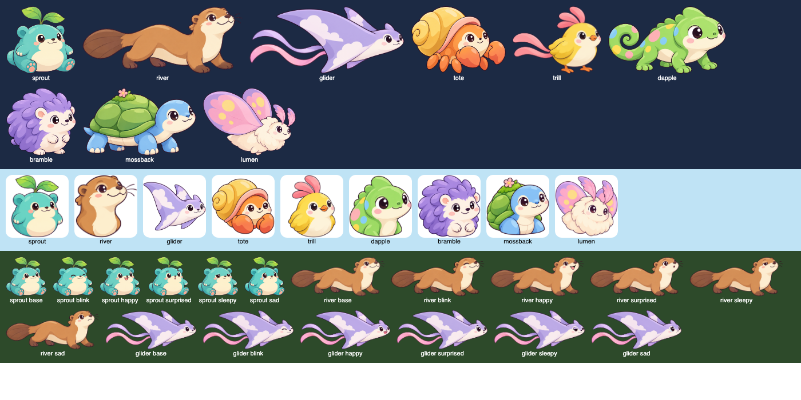

# Generated creature art: review of the routine's first pass (2026-10-19)

A review of what the [art request queue](art-requests/QUEUE.md) delivered between 2026-10-17 and 2026-10-18 (requests R01–R15, fifteen `codex/art-queue` pull requests, [#564](https://github.com/rjdunlap/neo/pull/564) to [#585](https://github.com/rjdunlap/neo/pull/585)), what it is good for, what is wrong with it, and what comes next. Nothing here changes the game; it sets the next art requests and the next code slices. The developer's decisions of 2026-10-17 stand: illustrated sprites on a mesh rig are the creature direction, and the assistant owns the assets.

## What the routine delivered

89 untouched originals in `docs/rework/concepts/generated/`, 127 MB, every one 1536 × 1024 (full body) or 1254 × 1254 (portraits, wearables, eggs, the card paper), with a manifest row, the exact prompts, three candidates reviewed per base and a review note per request. The routine kept to its brief: no cuts, no rigs, no code.

| Group | Requests | Files | What it is |
| --- | --- | --- | --- |
| Pilot three | R01–R03 | 22 | Glider, sprout and river: base, five expressions, portrait; the glider's raised-wing `alt` |
| Dressing | R04–R05 | 9 | Crown, scarf and Weather Wardrobe's seven items |
| Surfaces | R06–R08 | 6 | Treehouse home at day and dusk, the card paper, three starter eggs |
| Second wave | R09–R14 | 45 | Tote, Trill, Dapple, Bramble, Mossback, Lumen: full sets, four with an `alt` pose |
| Looks | R15 | 6 | Two colour looks per pilot species, edits of the chosen bases |

The queue now has no open row: R16 (forms) is blocked on RW11, and the routine's last run says so. The bottleneck has moved from generating pictures to cutting, rigging and showing them in the game.

## How it was checked

- **Contact sheets.** Every chosen base, portrait and `alt`, the pilot expressions, the wearables, scenes and looks were laid out at about 330 px and inspected on white, and the prepared sprites at the guide's size (about 120 px tall) on dark navy and the portraits at card size (110 px) on sky blue (the image above; a one-off Playwright script in `test-results/`, not kept).
- **The preparation pipeline, on every set.** `node scripts/creature-art/prepare-sprite.mjs --set <species> --check` was run for all nine species into a scratch folder (nothing committed under `src/`). Every set passed the alignment rule with its default 4 px tolerance: the six expression variants of each species trim to the same box within 2 px (the widest drifts are River's `happy`, 2 px taller at the top, and Trill's `surprised`, 2 px wider at the right). The paper key found a flat white (253–254) in every file, and the sprites showed no white fringe on dark at guide size.

| Species | Shared box (px) | Portrait (px) | `alt` (px) |
| --- | --- | --- | --- |
| Glider | 1506 × 660 | 1218 × 962 | 1506 × 674 |
| Sprout | 939 × 914 | 816 × 969 | — |
| River | 1482 × 632 | 908 × 903 | — |
| Tote | 1229 × 884 | 1205 × 1082 | 956 × 755 |
| Trill | 1271 × 975 | 799 × 1038 | — |
| Dapple | 1452 × 835 | 1104 × 1090 | — |
| Bramble | 979 × 947 | 1136 × 1129 | 995 × 938 |
| Mossback | 1349 × 809 | 1150 × 1069 | 1081 × 706 |
| Lumen | 1229 × 898 | 1063 × 1019 | 918 × 931 |

- **Not checked:** motion (no set is rigged yet), an iPad, 2× fringe at the ink edge, a child's reaction, and the usage terms beyond what the manifest records.

## Assessment

**The cast works.** All nine read by silhouette alone at card size: round sitter, long walker, glider, scuttler, hopper-bird, climber, roller, carrier, flutterer, as the [cast](art-requests/CAST.md) asked. The shared rules held across fifteen separate conversations: the same plum ink, cream belly, blush, glossy two-highlight eyes, right-facing three-quarter view and flat white ground. Placed side by side (above) they look like one family drawn by one hand, which is the thing a generated cast most often fails at. The expressions are legible at guide size (sad and sleepy differ; surprised is a round mouth, not a scream), and the variants hold still, so the whole-texture swap under one mesh that the pilot planned will work without hand alignment.

**Resolution is fixed.** The RW02b stand-in was 458 px across (1.4 px per logical unit, soft on an iPad). These bases are about 1500 px across: 4 px per unit at stage scale, twice what a 2× iPad needs. The right production size is a 0.5 downscale, which also keeps a species' six expressions near 6 MB of texture instead of 24 MB.

**What is wrong, in order of how much it matters:**

1. **The glider's portrait is the weak card.** On the blue card row it is the smallest and palest of the nine, and its face is drawn rounder and larger than the base's, so the card and the creature read as two designs. Fix by a re-roll with a bigger head, the body filling the frame and a deeper lavender (R17 below); the pilot already noted the card problem.
2. **The wearables were drawn from the front.** The sunglasses, raincoat, mittens and boots are front or near-front views; the creatures are side-on three-quarter views. A front-on raincoat will not sit on a side-on otter. The crown (a tilted ring), the sun hat, the beanie and the umbrella (a held prop) will fit. Decide item by item in code before re-rolling anything: the pilot rig fits the crown and scarf already; a test-fit of all nine on the three pilot rigs is a session's job, and only the items it rejects go back to the queue (R18, blocked on that fit).
3. **The home scenes are painterly.** Day and dusk are lovely and the foreground is clear for the creatures, but they are far denser than the flat lands and the brief says painterly detail is not a runtime requirement. They fit RW06's home. They also show the gap the companions will open: an illustrated companion beside a flat `Graphics` duck in Duck Pond. That is accepted for the pilot ([game fit](art-requests/GAME-FIT.md#what-stays-code-drawn)), and the ladder for closing it is below.
4. **Minor, no action:** the glider's raised-wing `alt` is mostly cream and nearly vanishes on white (fine on sky and dark, which is where it flies); Trill's tail ribbons echo the glider's (distinct at card size by colour and body); Trill's forehead highlight sits upper right; the three `alt` poses that retract (Tote, Bramble, Mossback) regenerate the surfaces the pose reveals and are separate pictures, as their notes say; the card paper is nearly flat cream and needs a tint per species to do any work.

## What is next

The next steps are code slices, not image requests, until the pilot three stand in the game. In order:

1. **Prepare and rig the pilot three** (RW02b step 2; built 2026-10-19, [PR #609](https://github.com/rjdunlap/neo/pull/609), [result](GENERATED-CREATURE-PILOT.md#step-2-result-2026-10-19)). Run `--set` for sprout, river and glider into `src/art/creatures/illustrated/`, at half size, with a manifest row each; write `SPROUT_ART`, `RIVER_ART` and a new `GLIDER_ART` from the trimmed bounds (face, slots, pinned body, moving parts with root and tip, the touch circle, misfits: the [anchor list](art-requests/GAME-FIT.md#anchor-points-a-rigging-session-records)); give each a mesh with weights (leaves and arms sway on the sprout; a wave runs down the river's back and its tail; the glider's wing and ribbons as today); swap `blink`, `happy`, `surprised`, `sleepy` and `sad` as whole textures under the mesh, replacing the painted lids; test-fit the crown and the scarf; show all three beside the Graphics rigs in `/?creatures`; delete the stand-in glider sprite and its wrapper. Proof: typecheck, the creature unit tests (every set's size, alignment, pinned face, bounded vertex motion), one preview probe in both orientations, and `npm run build` to confirm the sprites stay out of the production bundle until RW05 ships them.
2. **RW05 slice 1** then takes the illustrated rigs as the species' renderers instead of the Graphics sprout and river its packet planned around. It also owns the first collection surfaces: the portraits over the tinted card paper (R07), and the egg (R08) in the kept hatch, which needs the hatching stages below.
3. **Fit the wearables** (RW06's dressing): the nine items on the three rigs, anchored per species, with the front-view items judged and sent back as R18 if they fail.
4. **Prepare the second-wave six** once the rig pattern is settled: the same script and a smaller `*_ART` table each, no new mechanism; the collection book (RW10) is what shows them.
5. **Casting poses** (asleep, peeking, carrying) only when a casting proof slice is chosen, as the [integration review](PET-INTEGRATION.md#what-this-asks-of-the-art) says (R19).

**Added to the queue** ([QUEUE.md](art-requests/QUEUE.md)): R17, the glider portrait re-roll (open); R18, a hatching egg in three stages per colour (open: the kept hatch needs it); R19, the wearables re-drawn at the cast's angle (blocked on the fit); R20, casting poses (blocked on the casting slice); R21, expression sets for an adopted look (blocked on RW10); R22, the friends, duck first, and R23, land backdrops (both blocked on a developer decision, below).

## Uplifting the rest of the game

The companions will be the best-drawn things on screen. Everything around them, the friends and hosts, the land backdrops, the hub icons, stickers and buttons, is flat `Graphics` in the shared palette. That contrast is the real "quality of things in-game" question, and the queue deliberately left it out ("not requested") because it is a catalog-wide decision. The ladder, cheapest and least risky first:

1. **See the companion in the game first.** Nothing is decided until the illustrated sprout stands in Splish Splash and Duck Pond on an iPad (RW05 slice 1 plus the device check). Most of the uplift the developer asked for comes from this step alone: the guide, the result star, the chooser card and the treehouse resident all become illustrated.
2. **One land as a pilot, not a reskin.** Rainbow Meadow (the sprout's home) with an illustrated backdrop in the home scene's style but flatter, and the duck, the friend in fifteen games, redrawn in the art bible's rules on the same pipeline. Judge the pair on the device beside the untouched lands.
3. **Then decide** whether the friends and hosts follow (one request per friend, like a species set without expressions), whether the land backdrops follow, and whether hub icons and stickers stay code-drawn (they are small, numerous and seeded; they should).

This is a [developer decision](../WAITING-ON-DEVELOPER.md) now, with that lean recorded, so the routine cannot start R22 or R23 on its own.

## Not established

Motion on any of the nine; frame rate with six expression textures resident; whether a two-year-old tells the species apart or prefers them to Pip; whether the painterly home reads as the same world as the flat lands; the exact ink-edge quality at 2×; child appeal of any of it.
