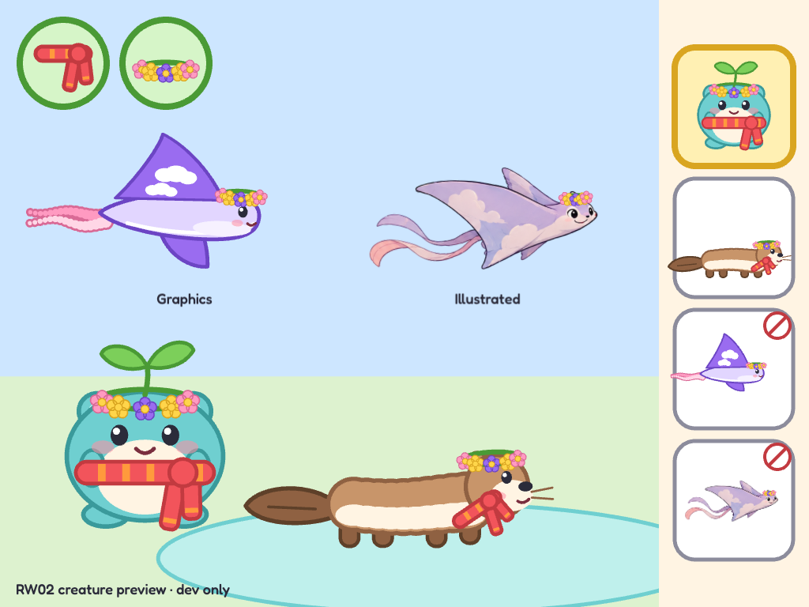
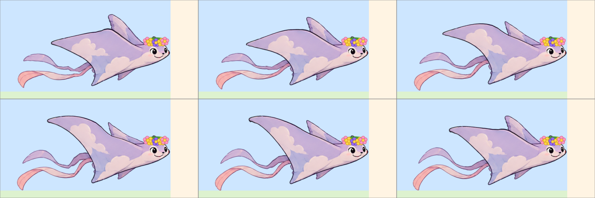

# RW02b: Generated creature art and animation pilot

**Status:** partly done. On 2026-10-17 ([PR #503](https://github.com/rjdunlap/neo/pull/503)) the preparation pipeline, mesh rig and comparison were proven on a stand-in cut from the concept sheet; see [Pilot result](#pilot-result-2026-10-17). **First-slice step 1 (generate candidates) is still ready.** The building session had no image tool, so the developer will run the passes in ChatGPT with the [art bible](ART-BIBLE.md) and [prompts](ART-PROMPTS.md) (2026-10-17); a session then prepares and rigs the chosen images. Defined 2026-10-17 as a follow-up to [RW02 / PR #499](https://github.com/rjdunlap/neo/pull/499), before production art is consumed by RW05. [Work-item index](WORK-ITEMS.md#rw02b-generated-creature-art-and-animation-pilot).

## Developer decision and ownership

On 2026-10-17 the developer approved changing the rule against imported sprites: “I'm fine changing that rule about sprites, it's more I wouldn't be able to make them.” Generated raster sprites, layered illustration and texture atlases are allowed. The assistant owns asset generation, preparation, integration and documented reproduction; the developer is not expected to draw, cut layers, clean frames or animate them. The sound synthesis rule remains unchanged. This permission does not select a final style, approve a whole-game reskin or require a paid animation product.

## Problem and outcome

The developer still found the creatures, especially the glider's wings, below the quality of the [concept sheet](concepts/art-directions-2026-10-16.png) after several code-drawn revisions. Rebuilding generated illustrations with simple Pixi Graphics curves loses their shape, warmth and volume; scaling rigid wing shapes limits animation. This is an assessment of this prototype, not proof that vector art cannot achieve that quality.

Deliver one polished **cloud glider** in an isolated dev preview: a coherent illustrated sprite with an idle, a wingbeat and a touch reaction, plus a small collection portrait and a wearable crown. Compare it directly with the existing Graphics glider at the same on-screen sizes. Keep the other two creatures and the game's normal front door intact. Do not expand to the full cast until this experiment establishes a repeatable workflow.

## Read first and preserve

- [Current art packet](CREATURE-ART.md), concept sheet and `src/art/creatures/glider.ts`, `creature.ts`, `accessories.ts`, `creatures.test.ts`; preview: `src/dev/creature-preview.ts`, opened with `/?creatures` in development.
- The current stable species ID is `glider`; it supports a crown on `head` and deliberately declines a scarf. Preserve those semantics and minimum touch targets.
- Inspect `git status` and current main before editing. The defining session used `codex/rw02-review`, based on `97efae1`, and left review/art changes **uncommitted**. Do not assume those changes are merged or available in a fresh checkout. PR #499 is the merged baseline; determine what subsequent work actually exists.
- Ignored `test-results/rw02-*.png` and probes may exist in that worktree, but are not durable dependencies. Keep accepted source art and reproducible tools in tracked project files, with a short manifest. Do not rely on this chat, temporary outputs or a particular local path.

## First slice

1. Use the available image-generation tool and its skill to generate a small set of glider candidates from the concept sheet. Aim at its illustrated-adventure warmth: broad soft manta wings, clear attachment to the body, a readable friendly face, pale lavender/cream cloud markings and flowing ribbons. No need for pixel art or a soft-toy rendering experiment. Supply the concept and approved candidate as visual references for subsequent edits; use the shared palette as the color guide.
2. Choose and preserve one strong static design before animating it. Inspect the full-size creature and its 150-unit card portrait. Keep lighting, proportions, markings and camera angle fixed across assets. A beautiful large image that fails at game size is not sufficient.
3. Prefer **layered illustration plus controlled animation**: separate near/far wings, body, face and ribbons, with hidden overlap under moving parts. Prepare clean alpha edges. Use deformable wing geometry or a few explicit wing poses so the roots stay attached while the tips bend; do not merely shrink the entire wing vertically. Keep eyes and the crown separately controllable.
4. Use the smallest renderer that proves the result. Existing Pixi textures, containers and a small mesh/pose rig are a reasonable starting point. Spine is an optional candidate, not a mandatory dependency or purchase; check its current capabilities/license if chosen. If automatic layer extraction is unavailable, the assistant must use another workable asset-preparation approach or pose-based animation, not hand the drawing work back to the developer.
5. Add one idle, a complete wingbeat cycle and one touch reaction. A reference-driven short video or generated key poses may help, but extracted frames require inspection and cleanup for drift, alignment and loop seams. A generic “make a spritesheet” prompt is not acceptance. Use alternate artwork for folds/undersides when deformation cannot represent them convincingly.
6. Wire a temporary comparison in the existing dev preview. Preserve species identity, input behavior, accessory handling and cleanup. Keep runtime generation out of the app: ship prepared local assets only. Record how RW05 will consume the accepted renderer and remove the comparison; do not introduce a permanent old/new mode.

## Acceptance and proof

- Compare old/new idle and reaction at identical gameplay and collection sizes in landscape and portrait, dressed and bare. The new version should visibly preserve the concept's broad wing silhouette and integrated body; show the result for review without claiming aesthetic approval in advance.
- Motion has stable anatomy, face and markings; wing roots do not separate; wings bend rather than behave like hinged paper cutouts. Inspect a complete cycle, including the loop boundary and repeated taps.
- Crown stays attached without hiding the face; unsupported scarf behavior stays explicit. Hit targets stay at least 100 logical units after scaling, with immediate feedback and palm rejection.
- Prepared assets have true transparency, consistent scale/origin, sufficient padding and clean edges on both light and dark backgrounds. Commit source/reference assets, export dimensions, pivots/attachment metadata, prompts/settings and any preparation scripts needed to reproduce the result; record generation tool and relevant usage terms. Avoid embedding temporary URLs, secrets or machine-specific paths.
- Run typecheck, focused creature/attachment tests and one filtered preview probe covering inputs, crown, card fit, repeated taps, both orientations and exit cleanup. Review screenshots plus the actual motion. Run build to check asset loading and production isolation; if assets enter the production bundle/cache, add the production offline check. No unrelated game/world suites for an isolated preview.
- Record asset/atlas sizes, display-object count and observed preview frame timing, distinguishing desktop/headless results from iPad performance. iPad touch/performance and child preference remain open until observed; they do not block making a reviewable pilot.
- Finish with a short recommended workflow, actual generation/cleanup effort, remaining defects and whether the result warrants extending to sprout/river. A still image alone is not completion. Stop after this pilot; no collection/save/route cutover or catalog reskin.

## Research carried forward

Reviewed 2026-10-17; these are starting points, not independently benchmarked product endorsements. Reddit reports are anecdotal and may include vendors.

- [Sketch → static image → animation → spritesheet](https://www.reddit.com/r/aigamedev/comments/1sisx27/finally_smoothed_out_the_animation_w_new/): an example of approving the source image before motion.
- [Generation, animation and Aseprite cleanup](https://www.reddit.com/r/aigamedev/comments/1s76q5f/finally_figured_out_how_to_make_decent_animations/): a working multi-tool account, including face cleanup; its pixel-art specifics are not our target style.
- [Sprite workflow difficulties](https://www.reddit.com/r/aigamedev/comments/1x1abfa/workflow_for_sprites/): static quality does not establish consistent animation.
- [Spine meshes](https://us.esotericsoftware.com/spine-meshes), [Pixi runtime](https://us.esotericsoftware.com/spine-pixi), [skins/attachments](https://en.esotericsoftware.com/spine-runtime-skins): technical candidates for deformation and dressing.
- [Scenario layer extraction](https://help.scenario.com/articles/8235214611-image-to-layers-and-video-to-layers-the-essentials): optional assistance, with output still needing inspection.
- [Unity's image/video/spritesheet workflow](https://unity.com/blog/unity-ai-sprite-generator): confirms that approach, explicitly presented as prototyping rather than guaranteed finished art.

## Next-session starting instruction

Implement RW02b from this packet. Inspect the actual worktree/main state, preserve unrelated work, generate and integrate one illustrated glider using available tools, and return a playable comparison plus reproducible assets and focused verification. The developer has approved sprites and is not expected to make the artwork. Do not ask again whether sprites are allowed. Final cast/style selection and rollout remain separate decisions.

## Pilot result (2026-10-17)

Built on `claude/rw02b-illustrated-glider` from merged `main` (`b6b2a68`). The uncommitted `codex/rw02-review` changes to the Graphics species were left alone; the comparison's "Graphics" side is the merged PR #499 glider.

**What exists.** Open `/?creatures` in a dev build. An illustrated glider (`src/art/creatures/glider-illustrated.ts`) stands beside the Graphics glider at the same stage scale, with a fourth collection card at the same card scale. Both take the crown and decline the scarf, use the same 112-unit touch circle at stage scale, the same loop-the-loop and the same accessory toggles.

**The art is the concept sheet's glider, not a new generation.** This session had no image-generation tool. So the pilot cut the "Illustrated adventure" glider out of the committed concept sheet as a labelled stand-in, to prove preparation, rig and comparison.
- **Rebuild:** run `node scripts/creature-art/prepare-glider.mjs`.
- **Manifest:** [`src/art/creatures/illustrated/README.md`](../../src/art/creatures/illustrated/README.md).
- **Still open:** step 1's candidate set (several generated gliders, a chosen design, consistent re-generation for poses or layers). The next session with an image tool should start there, re-run the same preparation and keep the rig. The next-session instruction below still applies, starting at step 1.

**Animation: a deformable mesh, not layers.** A flat image has no hidden overlap to cut layers from, so the sprite rides a 30 × 14 mesh and vertices move by weight:
- the body and face are pinned;
- the wing moves by its distance from the root along the root→tip line, as a wave whose tip lags, so it bends rather than hinges and its root cannot part from the body;
- the far fin beats against the wing;
- the ribbons ripple behind the trailing edge.

The wing beats at 2.2 rad/s at idle and eases up to 9 rad/s during the touch loop. Its phase accumulates and the reaction's strength is eased, so neither the start or end of a reaction nor a quick re-tap snaps the wing; a test bounds every vertex's movement per frame, and it failed at 15 px before this was fixed. The painted eyes cannot close, so a lid of wing colour with a lash line covers each one for a blink.

| Measured (dev, not iPad) | Graphics glider | Illustrated glider |
| --- | --- | --- |
| Display objects | 88 | 17 (one mesh, lids, slot) |
| `update()` per frame, Node | ≈3.7 µs | ≈19 µs (420 vertices moved and uploaded) |
| Asset | none | 458 × 206 PNG, ≈99 KB file, ≈0.5 MB GPU with mipmaps |
| Headless preview, four gliders plus sprout and river | — | 7–10 fps in software rendering, against ≈21 fps for RW02's six creatures in the same kind of harness; says nothing about an iPad |

**Proof.**
- **Unit tests** (`glider-illustrated.test.ts`, 7 tests):
  - same species, slots and scarf misfit as the Graphics glider;
  - touch circle ≥ 100 units at stage scale;
  - the sprite's recorded size, a transparent border and opaque eyes;
  - face and wing root pinned through idle and three taps (two in quick succession);
  - the wing tip travels more than 12 px;
  - no painted pixel stretches past double;
  - the tip/mid ratio varies (a bend, not a hinge);
  - no vertex moves more than 8 px between frames through a reaction's start, its end and a quick re-tap;
  - the crown rides the loop and settles;
  - destroy frees the geometry and not the shared texture.
- **Preview probe** (`test-results/rw02b-probe.mjs`, Chromium headless, 1024 × 768 and 768 × 1024):
  - two quick taps restart the reaction;
  - the crown and scarf toggles work dressed and bare;
  - cards fit;
  - leaving to the chooser raised no page errors.
- **Wingbeat strips:** three strips were inspected as stills: idle, touch, and the reaction's end with the loop live (six frames each). The real-time motion was not watched by a person.
- **Edges:** the sprite was checked on light, dark and checkerboard backgrounds.
- **Production build:** no sprite or preview code in `dist/` or the precache, so no offline check is needed.

**Assessment.** The illustrated glider keeps the concept's broad wing, integrated body, cloud markings and ribbons, which is what the Graphics version lost. **Developer verdict (2026-10-17): "the illustrated looks much better."** Illustrated sprites on a mesh rig are the creature direction. RW05 keeps the illustrated glider and deletes the Graphics glider; sprout and river follow once real candidates are generated (step 1).

**Defects and limits:**
- **Soft source.** About 1.4 sprite pixels per logical unit on the stage, so about 0.7 per device pixel on a 2× iPad: visibly soft up close. A production generation should be at least 2–3× larger.
- **Weak at card size.** It reads paler and smaller than the Graphics glider at card size on white. A card background tint or a slightly larger card scale would help.
- **Covered ears.** The crown covers the ear tips.
- **Painted lids.** The blink lids are painted patches. A generated eye-closed variant would look better.
- **Ribbon kink.** The upper ribbon compresses slightly where it leaves the wing at the beat's extreme.
- **Loop restart.** A re-tap mid-reaction restarts the craft's loop with a small jump (about 17 units), inherited from the Graphics glider; the mesh itself does not jump.
- **No underside view.** The wing never shows its underside; a mesh cannot fold, so a deeper beat needs alternate artwork.

**Recommended workflow:**
1. Generate a large (≥1400 px wide) side view on flat paper, plus an eyes-closed variant.
2. Prepare it with this script, given a new box and seed.
3. Mark root, tip and face points in a `*_ART` table.
4. Reuse this weight-field mesh rig per species.

Effort for this pilot: about an hour of preparation and tuning. Nearly all of it went to edge de-fringing and weight-field boundaries, not drawing.

**Extending to sprout and river.** Worthwhile only after a real generation pass: the sprout's leaf sway and the river's spine wave map onto the same weight-field approach. Do not reskin them from the concept sheet, which is too small.

**Hand-off to RW05.** RW05 keeps one glider renderer and deletes the other, the `art` comparison entry in `src/dev/creature-preview.ts` and the texture load in `main.ts`'s dev hook. If RW05 keeps the illustrated version, it moves the asset loading into the collection's own scene load and makes card thumbnails still textures as [CREATURE-ART.md](CREATURE-ART.md#production-recommendation) recommends.

**Not established:**
- iPad frame rate and touch feel;
- a child's preference between the two;
- whether anyone watching the real motion finds it convincing.

These are in [device checks](../DEVICE-CHECKS.md).
